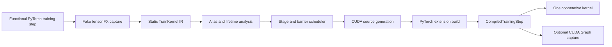

# Compiler design

## Capture

`capture()` flattens the input pytree and uses functionalization plus fake-mode FX tracing to obtain an ATen graph without applying updates to example inputs. `compile_training()` adds a checked contract for `(state, *data) -> (loss, gradients, updated_state)` and derives the state mapping from the returned tree. PyTorch supplies differentiation when the function contains `torch.func.grad_and_value`. The compiler lowers supported operations into a small SSA representation with explicit tensor shape, dtype, root buffer, offset, and strides.

The capture boundary rejects input writes, tensor constants hidden in closures, unsupported operators, and unsupported dtypes. Python scalar constants are specialized into the generated source. Views carry aliases instead of executing a new task. Materialized outputs use contiguous layouts; later view strides are derived from those layouts rather than blindly copied from tracing metadata.

## Scheduling and storage

The first scheduler processes operations in topological order. Single-consumer pointwise producers can be evaluated inline by their consumer, preserving rounding at each logical dtype boundary. An arena planner keeps roots alive through their last materialized reader, including readers reached through inline expressions and views. Returned values stay live through completion. Compatible contiguous outputs are written directly to caller output storage and can be read there by later operations; other views are materialized at the end. Native output buffers have separate dependency regions and do not reserve arena storage. Discarded GEMM roots can be computed directly into fused output epilogues. The arena still holds genuine intermediates and does not claim minimal storage. Pure outputs are independent contiguous materializations; the checked training API explicitly aliases selected updated state outputs to inputs. Original view strides are outside the output contract.

A cooperative grid remains resident for the whole step. All blocks execute the same operation sequence and stride over output tiles. The compiler groups independent operations into stages and inserts a barrier when a read-after-write, write-after-read, or write-after-write hazard crosses the current stage. It compares workspace intervals as well as logical dependencies, so arena reuse cannot silently create a race. A single-block grid uses block barriers. State updates are committed directly only after a proof that no later read observes the old value; cross-index, transposed, or aliased updates use staged output and a final commit. This remains a static schedule rather than a dependency-counter task queue.

Short reductions with multiple outputs assign an output to each thread, keeping adjacent feature reads coalesced. Other reductions use block-local shared-memory reduction or a bounded two-pass partial reduction for long rows. The grid is capped by both occupancy and the graph's available tile work.

## Matrix multiplication

The BF16/FP16 path normally assigns four warps to a 32 by 32 output tile; an optional 32 by 64 tile is available for experiments. Matrices with both output dimensions at most 16 use one active warp and a 16 by 16 tile. K staging is configurable at 16 or 32. A/B tiles are staged in shared memory, including coalesced loads for transposed contiguous operands. Tail elements are zero-padded. Very short K or M uses a direct SIMT path, and selected row-vector products can partition K across warps. A canonicalization pass changes an observed transposed matmul into an equivalent physical output layout. Fused epilogues write eligible pointwise outputs without storing the intermediate GEMM. `addmm` applies its bias/alpha/beta epilogue before the output dtype conversion. FP32 uses SIMT rather than silently reducing precision to TF32.

The host computes active blocks per SM for the compiled kernel and clamps the cooperative grid to that occupancy. The standard block size is 128 threads; 256, 512, and 1024 threads are supported when all matrix products use the direct SIMT or row-vector path. GPU capability and cooperative-launch support are checked.

## Runtime

CUDA source is compiled through PyTorch's extension builder and cached using a source, architecture, and PyTorch-version digest. Calls validate the static tensor signature and allocate independent output/workspace storage. `compiled.runner.allocate()` and `run_into()` expose caller-owned buffers for experiments, with device, layout, size, and alias checks. Shared execution buffers require the caller to order reuse correctly.

`CapturedProgram` wraps a fixed-address CUDA Graph for repeated calls. Capture includes warmup and state restoration, while replay returns borrowed output buffers. It does not replace Python's data pipeline or provide autograd registration for an arbitrary forward function. The caller supplies an explicit pure training function returning gradients and updated state.

## Limits and next experiments

The cooperative schedule pays a growing cost on large matrix products, where cuBLAS and Inductor can use more specialized kernels. A future cost model could split large graphs, and a native-width temporary arena could reduce BF16 traffic. The H100 pass added a measured opt-in SM90a WGMMA path, but the tested WGMMA schedules were slower than the selected WMMA path on small and medium training workloads. TMA and warp-specialized pipelines remain future work.
